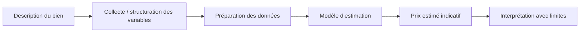

# Berkane Immo ML — Présentation du projet

## Contexte
Le marché immobilier à Berkane évolue selon plusieurs facteurs (quartier, surface, état du bien, équipements, etc.). Le projet **Berkane Immo ML** a été conçu comme prototype académique pour explorer comment une estimation de prix peut être structurée à partir de données immobilières et présentée de manière compréhensible.

## Problématique
Comment proposer une estimation indicative du prix d’un bien immobilier à Berkane, en tenant compte de variables hétérogènes, tout en gardant une approche pédagogique et transparente sur les limites d’un tel système ?

## Objectifs
- Expliquer la logique d’un projet d’estimation immobilière assistée par machine learning.
- Structurer les étapes du flux (données → modélisation → estimation).
- Présenter une expérience utilisateur de saisie des caractéristiques d’un bien.
- Documenter les limites d’un prototype académique non destiné à un usage d’expertise.

## Fonctionnalités prévues / réalisées
- Présentation d’un formulaire d’estimation basé sur les caractéristiques du bien.
- Chaîne conceptuelle de préparation des données et d’estimation.
- Affichage d’un résultat indicatif de prix.
- Documentation de l’approche et des précautions d’interprétation.

## Données et variables (description générale)
Le projet s’appuie sur des variables immobilières classiques :
- **Localisation** : quartier.
- **Caractéristiques du bien** : type, état, surface, étage, ancienneté.
- **Capacité** : nombre de chambres et de salles de bain.
- **Équipements** : balcon, jardin, garage, climatisation.
- **Variable cible** : prix du bien (MAD).

> Les données de démonstration mentionnées dans l’historique du projet sont synthétiques et servent à l’illustration de la démarche.

## Architecture conceptuelle

## Flux de fonctionnement (sans code)
1. L’utilisateur décrit un bien immobilier (quartier, surface, état, etc.).
2. Les informations sont normalisées selon les variables du projet.
3. Le moteur d’estimation applique la logique de modélisation définie dans le prototype.
4. Un prix indicatif est restitué.
5. Le résultat est interprété avec prudence (contexte local, qualité des données, spécificités du bien).

## Cas d’utilisation
- Démonstration académique d’un cas d’usage IA appliqué à l’immobilier local.
- Support pédagogique pour expliquer un pipeline d’estimation de prix.
- Base de discussion pour un futur projet plus robuste avec données réelles qualifiées.

## Résultats documentés
Les résultats historiquement documentés dans le projet provenaient d’une démonstration **sur données synthétiques** :
- Algorithme : `RandomForestRegressor`
- Données : `synthetic-demo`
- Volume : 600 lignes (120 pour l’évaluation)
- Indicateurs rapportés : MAE = 141910.03 MAD, RMSE = 188199.37 MAD, R² = 0.9321

Ces résultats ne constituent pas une validation métier du marché immobilier réel de Berkane.

## Limites
- Prototype académique, non destiné à une expertise immobilière professionnelle.
- Résultats dépendants de la qualité, de la représentativité et de l’actualité des données.
- Les spécificités fines d’un bien (nuisances, qualité réelle des finitions, micro-localisation) peuvent fortement impacter le prix.
- Les performances observées en démonstration synthétique ne garantissent pas une performance équivalente en conditions réelles.

## Perspectives
- Intégrer des données réelles, récentes et juridiquement exploitables.
- Renforcer la validation statistique et métier avec des acteurs du domaine.
- Ajouter des mécanismes de suivi de dérive des données.
- Améliorer l’explicabilité des estimations et la communication d’incertitude.

## Illustrations du projet
### Interfaces

### Éléments visuels

## Crédits
Le site académique d’origine a été créé par **ALLAOUI Yassine** et **EL AAMRI Ayoub**. Ce dépôt conserve une présentation du projet et de sa démarche.
